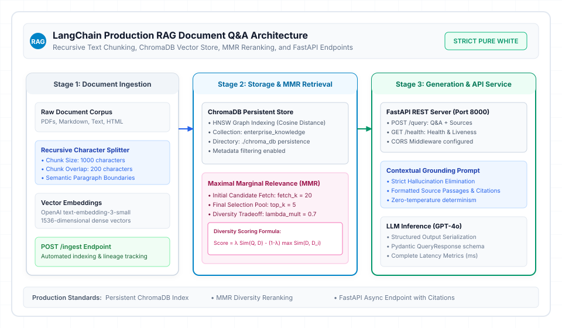

# LangChain Enterprise RAG Document Q&A Pipeline

[](https://github.com/tayyabmasood911/langchain-rag-document-qna-pipeline/actions)
[](LICENSE)
[](https://langchain.com)
[](https://trychroma.com)
[](https://fastapi.tiangolo.com)

A production-grade Retrieval-Augmented Generation (RAG) pipeline built with LangChain, ChromaDB persistent vector database, semantic recursive character chunking, Maximal Marginal Relevance (MMR) diversity reranking, and a high-performance FastAPI query endpoint.

---

## Architecture Overview



The pipeline executes a strictly controlled three-phase workflow designed to eliminate LLM hallucinations:

1. **Ingestion & Semantic Chunking**: Raw enterprise documents are partitioned using `RecursiveCharacterTextSplitter` (1000 chunk size, 200 overlap) to preserve contextual boundaries and metadata lineage.
2. **Persistent Vector Storage & MMR Reranking**: Chunks are embedded and indexed in ChromaDB using HNSW cosine index graphs. Queries retrieve an initial candidate pool (`fetch_k=20`) and apply Maximal Marginal Relevance (`top_k=5`, `lambda_mult=0.7`) to maximize information coverage while discarding semantic duplicates.
3. **Synthesis & API Serving**: A FastAPI REST server processes incoming queries, formats source documents with strict citations, grounds generation using zero-temperature parameters, and returns answers alongside full source lineage.

---

## Core Features

- **Semantic Recursive Chunking**: Dynamic paragraph, sentence, and phrase boundary detection ensuring context does not get truncated abruptly.
- **Maximal Marginal Relevance (MMR)**: Replaces standard nearest-neighbor search with diversity-optimized reranking, preventing redundant passages from consuming LLM context window space.
- **ChromaDB Persistent Store**: Built-in on-disk persistence for embedding vectors, collection indexing, and metadata tagging.
- **FastAPI Production Service**: Fully documented REST endpoints (`/query`, `/ingest`, `/health`, `/docs`) with Pydantic validation schemas.
- **Comprehensive Lineage Tracking**: Every answer links back to exact source passages with character offsets, document names, and latency benchmarks.

---

## Quick Start

### 1. Install Dependencies
```bash
pip install -r requirements.txt
```

### 2. Configure Environment
```bash
cp config/production.env.example .env
# Edit .env and supply your OPENAI_API_KEY
```

### 3. Launch FastAPI Server
```bash
uvicorn app:app --host 0.0.0.0 --port 8000 --reload
```

### 4. Ingest Documents
```bash
curl -X POST http://localhost:8000/ingest \
  -H "Content-Type: application/json" \
  -d '{
    "text": "Retrieval-Augmented Generation (RAG) optimizes LLM output by referencing an authoritative knowledge base outside of its training data before generating a response. Maximal Marginal Relevance (MMR) balances relevance and diversity.",
    "source": "architecture-overview.md"
  }'
```

### 5. Query the Pipeline
```bash
curl -X POST http://localhost:8000/query \
  -H "Content-Type: application/json" \
  -d '{
    "question": "How does MMR optimize retrieval?",
    "top_k": 3,
    "lambda_mult": 0.7
  }'
```

---

## Configuration Reference

Key variables defined in `.env`:

| Parameter | Default | Description |
| :--- | :--- | :--- |
| `API_PORT` | `8000` | Port for the FastAPI server |
| `MODEL_NAME` | `gpt-4o` | LLM model for contextual answer synthesis |
| `TEMPERATURE` | `0.0` | Model temperature (0.0 for deterministic answers) |
| `CHROMA_PERSIST_DIR` | `./chroma_db` | On-disk storage path for ChromaDB index |
| `CHUNK_SIZE` | `1000` | Target character count per text chunk |
| `CHUNK_OVERLAP` | `200` | Overlap character count between consecutive chunks |
| `MMR_TOP_K` | `5` | Number of documents returned after MMR reranking |
| `MMR_LAMBDA_MULT` | `0.7` | Tradeoff factor (0 = maximum diversity, 1 = maximum relevance) |

---

## Verification & Testing

Execute the automated test suite:
```bash
python3 -m unittest discover -s tests -p "test_*.py"
```

Verify service health:
```bash
bash scripts/healthcheck.sh
```

---

## Security & Responsible Disclosure

Please review our [SECURITY.md](SECURITY.md) for vulnerability disclosure procedures. All security inquiries should be directed to [tayyabmasood911@gmail.com](mailto:tayyabmasood911@gmail.com).
